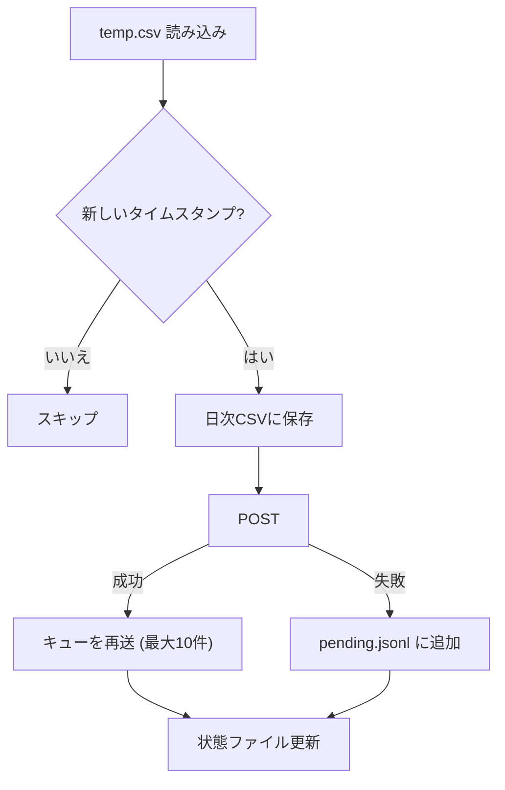

# new_sensor 修正計画書（POST停止対策 1〜6）

> [!IMPORTANT]
> 本書は**計画のみ**です。コードはまだ変更していません。
> 内容を確認のうえ「Go」をいただいてから実装します。
> 末尾の「確認事項」への回答もお願いします。

## 0. 背景と調査結果の要約

### 症状
- ラズパイ設置後、約5日でPOSTが止まる。
- 遠隔地のため、ネットワーク断かプログラム異常かを切り分けられない。

### 調査結論
実機ログと systemd / cron の設定が手元になく、**原因は断定できません**。
コードの静的解析で、停止・無送信につながる欠陥を6つ特定しました。

| # | 欠陥 | 対象 | 症状 | 可能性 |
|---|---|---|---|---|
| 1 | ADC読み取りが無限ループで固まり、`temp.csv` が更新されなくなる | measure_dT.py | プロセスは生存、POSTは「Data already sent」で無送信 | 高 |
| 2 | 例外時にプロセスが終了し、再起動されない | 全スクリプト | プロセスが消える | 中〜高 |
| 3 | POST成功時しかローカル保存しない。再送もない | post_data.py | 切り分け不能、欠測が回復しない | （設計上の欠陥） |
| 4 | 壁時計基準のスリープで、時計が戻ると長時間眠る | post_data.py / measure_dT.py | 戻った量だけ停止 | 低〜中 |
| 5 | ADC初期化失敗時にモックへ静かに切り替わる | measure_dT.py | ダミー値を送信し続ける | データ品質の問題 |
| 6 | 状態を外から確認できない（ログ・stale検知なし） | 全体 | 原因不明のまま | （設計上の欠陥） |

### 根拠（修正1の裏付け）
`adafruit-circuitpython-ads1x15 3.0.5` の `ads1x15.py` を確認しました。
単発変換モードの読み取りは、タイムアウトなしの無限ループです。

```python
if self.mode == Mode.SINGLE:
    # Continuously poll conversion complete status bit
    while not self._conversion_complete():
        pass
```

ADS1115 が応答しなくなると、`ch1_in.voltage` から戻りません。
`except Exception` には掛からず、ログも出ません。

## 1. 修正内容の全体像

### 変更・追加ファイル

| 区分 | ファイル | 内容 |
|---|---|---|
| 変更 | `measure_dT.py` | 修正 1, 2, 4, 5, 6 |
| 変更 | `post_data.py` | 修正 2, 3, 4, 6 |
| 変更 | `save_data.py` | 修正 3（重複防止・無条件保存への対応） |
| 新規 | `common.py` | ロガー、状態ファイル、sd_notify、アトミック書き込み（修正 1, 2, 6 の共通部品） |
| 新規 | `deploy/new_sensor-measure.service` | systemd ユニット（修正 2） |
| 新規 | `deploy/new_sensor-post.service` | systemd ユニット（修正 2） |
| 新規 | `deploy/README.md` | 導入・更新・確認手順（修正 2, 6） |
| 変更 | `.gitignore` | 実行時生成ファイルを除外（付随） |
| 変更 | `.env` | 新規の設定値を追加（後述） |

`dTmax.py` は変更しません。

### 実装順序
1. `common.py`（共通部品）
2. 修正 5 → 1 → 4（measure_dT.py）
3. 修正 3 → 4 → 2（post_data.py、save_data.py）
4. 修正 6（ログ・状態ファイル）
5. systemd ユニットと導入手順（修正 2）
6. テスト（第 3 章）

## 2. 修正詳細

---

### 修正1: ADC読み取りのウォッチドッグ

**対象**: `measure_dT.py`、`common.py`

#### 修正理由
- ライブラリの読み取りがタイムアウトなしの無限ループです（上記の根拠）。
- 電源の瞬断、I2Cノイズ、長いケーブル、Pi の I2C ハードウェアの既知の不具合などで ADS1115 が無応答になると、プロセスが生きたまま固まります。
- その結果 `temp.csv` が更新されず、`post_data.py` は毎分スキップするだけになります。ネットワークが正常でもPOSTが止まります。
- 現状は、固まっている間の記録が一切ありません。

#### 修正内容（三重の防御）

**(a) 読み取り単位のタイムアウト**
- `SIGALRM`（`signal.setitimer`）で、1回の ADC 読み取りに最大 2 秒の制限を掛けます。
- 無限ループは Python のバイトコード実行中なので、シグナルハンドラが割り込めます。ハンドラで `ADCReadTimeout` を送出します。
- 3ch 読み取り全体にも合計の制限（約 3 秒）を掛けます。

```python
class ADCReadTimeout(Exception): ...

def _alarm_handler(signum, frame):
    raise ADCReadTimeout("ADC read timed out")

signal.signal(signal.SIGALRM, _alarm_handler)

def read_raw_voltages():
    signal.setitimer(signal.ITIMER_REAL, ADC_READ_TIMEOUT_SEC)   # 既定 3.0
    try:
        return ch1_in.voltage, ch2_in.voltage, ch3_in.voltage
    finally:
        signal.setitimer(signal.ITIMER_REAL, 0)
```

**(b) 連続失敗時の ADC 再初期化 → 終了**
- 連続失敗の回数を数えます。
- 12回連続（約 1 分）で I2C と ADS1115 を再初期化します。
- 60回連続（約 5 分）失敗したら `sys.exit(1)` で終了します。systemd が再起動します（修正 2）。
- 閾値は `.env` で変更できます。

**(c) systemd ウォッチドッグ（最後の砦）**
- `Type=notify` と `WatchdogSec=180` を設定します。
- `temp.csv` の更新に成功したときだけ、`WATCHDOG=1` を通知します。
- (a)(b) をすり抜けて固まった場合（カーネル内の I2C 待ちなど）でも、180 秒で systemd が強制再起動します。
- `sd_notify` は `NOTIFY_SOCKET` への UNIX ソケット送信で実装します。**新規の pip 依存は不要**です。
- 環境変数がなければ何もしないので、開発機でもそのまま動きます。

#### 付随修正: `temp.csv` のアトミック書き込み
- 現状は `open(..., "w")` で切り詰めてから書くため、読み取り側がタイミングによって空や途中のデータを読みます。
- 一時ファイルに書いてから `os.replace` で置き換えます。

#### 影響・リスク
- `SIGALRM` はメインスレッドでしか使えません。現在は単一スレッドなので問題ありません。
- 再初期化で復帰しない場合（バス自体が固着）、再起動を繰り返します。次の対策を選べます。
  - `StartLimitAction=reboot` で OS ごと再起動する（確認事項 Q4）。

---

### 修正2: 例外ハンドリングとプロセス監視

**対象**: `measure_dT.py`、`post_data.py`、`deploy/*`

#### 修正理由
- メインループは `KeyboardInterrupt` しか捕捉しません。想定外の例外が1回出ると、プロセスが終了します。
- 再起動の仕組みがリポジトリにありません。docstring の `@reboot` cron だけなら、落ちたまま復帰しません。
- HTTP 通信が固まる場合の保険もありません（`requests` の `timeout` は各操作ごとで、全体の制限ではありません）。

#### 修正内容

**(a) ループ内の例外保護**
- 各ループの1周ぶんを `try/except Exception` で囲みます。
- スタックトレースをログに出して、次の周期へ進みます。
- 同種の例外が連続した場合は、待ち時間を段階的に増やします（最大 60 秒）。
- 致命的な場合のみ終了します（設定エラー、ADC の完全不通など）。

**(b) systemd ユニット**

`deploy/new_sensor-measure.service`（雛形）:
```ini
[Unit]
Description=new_sensor ADC measurement
After=local-fs.target time-sync.target
StartLimitIntervalSec=0

[Service]
Type=notify
User=<実行ユーザー>
WorkingDirectory=<リポジトリのパス>
ExecStart=<python のパス> -u measure_dT.py
Restart=always
RestartSec=5
WatchdogSec=180
NotifyAccess=main
Environment=PYTHONUNBUFFERED=1

[Install]
WantedBy=multi-user.target
```

`deploy/new_sensor-post.service`:
- 上と同様です。ただし `After=network-online.target time-sync.target` と `Wants=network-online.target` を指定します。
- `ExecStart` は `post_data.py` です。

**(c) post_data.py の HTTP 固着対策**
- `requests.Session` を使い、`timeout=(5, 10)`（接続 5 秒、読み取り 10 秒）に変更します。
- ループが1周するたびに `WATCHDOG=1` を通知します。
- 通信が固まって 180 秒間進まなければ、systemd が強制再起動します。

**(d) 終了コードとシグナル**
- `SIGTERM` を受けたら、安全にループを抜けて終了します（`systemctl restart` に対応）。
- 例外で終了する場合は、終了コードを非 0 にします。

#### 影響・リスク
- ユニットファイルのユーザー名、Python のパス、仮想環境の有無は**実機の情報が必要**です（確認事項 Q1）。
- 既存の cron `@reboot` と二重起動しないよう、`deploy/README.md` に cron の無効化手順を明記します。

---

### 修正3: ローカル保存の無条件化と再送キュー

**対象**: `post_data.py`、`save_data.py`

#### 修正理由
- 現状は、POST成功時にしか `data/` に保存しません。通信断の間のデータは、ローカルにも残らず欠測になります。
- ローカルに残らないため、設置後に「ネットワークが切れていたのか、プログラムが止まっていたのか」をデータから判断できません。
- 回線が復旧しても、欠測分は取り戻せません。

#### 修正内容

**(a) 日次CSVへの無条件保存**
- 新しいタイムスタンプを読み込んだら、POSTの成否にかかわらず、先に `data/` へ保存します。
- 保存済みのタイムスタンプは再保存しません。重複行を防ぐため、起動時に当日CSVの最終行から初期値を復元します。
- 列構成は変更しません。

**(b) 再送キュー（スプール）**
- 場所: `data/pending.jsonl`。1行に1ペイロードを書きます。
- POSTに失敗したペイロードを末尾に追加します。
- POSTに成功したら、キューを古い順に再送します（1サイクルで最大 10 件）。最初の失敗で中断します。
- キューの上限は 7 日分（10,080 件）です。超えたら古いものから破棄し、警告ログを出します。
- 書き込みは、一時ファイルから `os.replace` で置き換えます。

**処理の流れ**



#### 影響・リスク
- **サーバー側の仕様確認が必要です**（確認事項 Q2）。
  - 過去のタイムスタンプを受け付けるか。
  - 順序が前後しても問題ないか。
  - 同一タイムスタンプの重複を弾くか。
- サーバーが過去分を拒否する場合は、キューを使わず「ローカル保存のみ」にします。

---

### 修正4: 壁時計に依存しないスケジューリング

**対象**: `post_data.py`、`measure_dT.py`

#### 修正理由
- 次の実行時刻を壁時計で固定して持つため、時計が跳ぶと予定時刻との差が広がります。
- **時計が戻った場合**: 戻った量だけ眠ります（9時間戻れば9時間停止）。
- **時計が進んだ場合**: スリープなしで追いつくまで連続実行します。`measure_dT.py` は ADC を連続で読み、`samples` が異常な値になります。
- ラズパイは RTC がなく、NTP やタイムゾーンの変更で時計が跳ぶ可能性があります。

#### 修正内容
毎回、現在時刻から次のスロットを計算し、**1回のスリープを周期以内に制限**します。

```python
def seconds_until_next_slot(offset_sec: float, period_sec: float) -> float:
    """現在の壁時計から、次の (offset + n*period) までの秒数。常に 0 < 戻り値 <= period。"""
    now = time.time()
    wait = (offset_sec - now) % period_sec
    return wait if wait > 0 else period_sec
```

- `post_data.py`: `offset=20, period=60`。次の毎分20秒まで眠ります。
- `measure_dT.py`: `offset=0, period=5`。次の5秒境界まで眠ります。
- `next_sample` と `target_time` の累積は廃止します。

**時計の跳び検知（measure_dT.py）**
- 壁時計の経過と `time.monotonic()` の経過を比較します。
- 差が 2 秒を超えたら警告ログを出し、**その分の集計バッファを破棄**します。
- 時計の跳びで汚れた1分平均が、送信されなくなります。

#### 影響・リスク
- 動作は従来と同じ「毎分20秒に送信、5秒ごとにサンプリング」のままです。
- 時計が跳んだときは、最大でも1周期（60秒または5秒）で通常動作に戻ります。

---

### 修正5: モックデータへの無断フォールバックの廃止

**対象**: `measure_dT.py`

#### 修正理由
- 現状は、初期化時に何か例外が出ると、ログを1行出して**ダミー値**で動作を続けます（`_IS_MOCK = True`）。
- 起動直後に I2C が準備できていないだけでも、本番でダミー値を送信し続けます。
- 異常に気づけず、データも汚染されます。

#### 修正内容
- ハードウェア初期化を、import 時ではなく `init_adc()` 関数に移します。
- 初期化に失敗したら、5秒間隔で最大12回（約1分）再試行します。
  - 起動直後の I2C 未準備に対応するためです。
- それでも失敗したら、`sys.exit(1)` で終了します。systemd が再起動します。
- モックは、環境変数 `ALLOW_MOCK=1` を明示したときだけ有効にします（開発機用）。既定値は `0` です。
- モック有効時は、起動時に WARNING を出します。

#### 影響・リスク
- Windows など開発機で実行する場合は、`.env` に `ALLOW_MOCK=1` が必要になります。
- 開発機で import したときにハードウェアに触らなくなるため、テストがしやすくなります。

---

### 修正6: 状態ログ・状態ファイル・stale検知

**対象**: `common.py`、全スクリプト

#### 修正理由
- 現状は `print` のみです。出力先が journald、ファイル、端末のどれになるかは起動方法しだいで、ログが残らないこともあります。
- 「いつから止まったか」「何が原因か」を後から確認できません。
- データが古くなっていても検知できません（`temp.csv` が更新されていなくても、毎分「Data already sent」と出るだけです）。

#### 修正内容

**(a) ログ**
- `logging` に統一します。出力先は標準出力（journald に流れる）と、回転ファイル `logs/<name>.log` です。
- 回転は 2 MB × 5 世代で、合計約 10 MB です。ディスクを埋めません。
- 5秒ごとのサンプル行は DEBUG にします（ファイルには出しません）。
- 分ごとの要約、POST の結果、警告・エラーは INFO 以上で記録します。
- 現状は約 2.8 MB/日の出力ですが、これで大幅に減ります。

**(b) 状態ファイル `status_measure.json` / `status_post.json`**
- アトミックに上書きします。

| ファイル | 項目 |
|---|---|
| measure | `last_sample_ok_at`、`last_summary_at`、`adc_consecutive_errors`、`adc_reinit_count`、`clock_jump_count`、`started_at` |
| post | `last_post_ok_at`、`last_post_error`、`last_http_status`、`consecutive_failures`、`pending_count`、`stale_minutes`、`started_at` |

- 復旧後に `cat` するだけで、直前の状況が分かります。

**(c) stale 検知（post_data.py）**
- `temp.csv` のタイムスタンプが現在時刻より 3 分以上古ければ、WARNING を出します。
- 「通信ができない」と「測定が止まっている」を、ログ上で区別できるようにします。
  - `[STALE] temp.csv is 5 min old (measure_dT stopped?)`
  - `[NET] POST failed x N (consecutive)`
- stale が続いても、`post_data.py` 自体は動き続けます。

**(d) ハートビート**
- 10 分ごとに、状態の要約を1行ログに出します。

#### 影響・リスク
- ログ関連の変更が最も広範囲です（`print` の置き換え）。出力フォーマットが変わります。
- 現在のログを監視している仕組みがあれば、フォーマットの互換が必要です（確認事項 Q5）。

---

## 3. テスト計画

実機（ADS1115）がないため、開発機ではモックとシミュレーションで確認します。

| # | 対象 | 方法 | 期待結果 |
|---|---|---|---|
| T1 | 修正1(a) | ADC 読み取りを無限ループにするスタブに差し替え | 約3秒で `ADCReadTimeout`。ループが継続する |
| T2 | 修正1(b) | 連続例外をスタブで発生させる | 12回で再初期化、60回で終了コード1 |
| T3 | 修正1(c) | `sd_notify` の送信先を一時ソケットにして受信 | 更新成功時のみ `WATCHDOG=1` を受信 |
| T4 | 修正2 | ループ内で意図的に例外を発生させる | ログにトレースを出して継続する |
| T5 | 修正3 | 存在しない URL（接続不可）に向けて実行 | CSV 保存あり、`pending.jsonl` に蓄積 |
| T6 | 修正3 | ローカルのモック HTTP サーバーに切り替える | キューが古い順に再送され、空になる |
| T7 | 修正3 | 再起動を挟む | 当日CSVに重複行が出ない |
| T8 | 修正4 | `time.time` をパッチして ±数時間跳ばす | 最大でも1周期以内に通常動作へ戻る |
| T9 | 修正5 | ADC 初期化を失敗させる（`ALLOW_MOCK` なし） | 再試行後に終了コード1。モックに入らない |
| T10 | 修正6 | 通常実行、通信断、測定停止の3パターン | 状態ファイルとログが期待どおりに変わる |
| T11 | 全体 | 1 時間程度の連続実行 | 例外なし、ログ容量は想定内 |

> [!NOTE]
> 実機でのI2C固着の再現（修正1の実効性）は、開発機ではできません。
> 初回デプロイ後、数日間は状態ファイルとログを確認することを推奨します。

## 4. デプロイ手順案（実機）

1. `git pull` の前に、実機の `data/`、`dTmax.csv`、`.env` をバックアップします。
2. 既存の起動方法（cron `@reboot` など）を停止し、無効化します。
3. `deploy/*.service` をコピーしてパスとユーザーを調整し、`systemctl enable --now` します。
4. `systemctl status` と `journalctl -u new_sensor-*` で稼働を確認します。
5. `status_*.json` が更新されていることを確認します。

## 5. 付随して気づいた点（修正対象に含めるか要確認）

| 項目 | 内容 | 提案 |
|---|---|---|
| 実行時ファイルが git 管理下 | `dTmax.csv` と `data/*.csv` が追跡されている。実機で `git pull` すると、競合や上書きが起きる | `.gitignore` に追加し、`git rm --cached` で管理から外す |
| `.env` が git 管理下 | 現在はシークレットらしき項目はないが、将来の混入が心配 | `.env.example` を作り、`.env` を除外する |
| CSVヘッダの不一致 | `save_data.py` の docstring と既存サンプルが旧形式（`v1, ch2, ch3, dT`）。現行コードは `voltage, HS_data...` | 実機の既存CSVのヘッダを確認し、必要なら移行する |
| `dTmax.csv` の `sensor_name` | `def6f116` が入っている（既定は `new01`） | 実機の設定を確認する |

## 6. 確認事項（Go の前にご回答ください）

1. **Q1: 実機の環境**
   - 実行ユーザー名、リポジトリのパス、Python の起動方法（仮想環境の有無）。
   - 現在の起動方法（cron `@reboot`、systemd、手動 など）と、ログの出力先。
2. **Q2: サーバー側の仕様**
   - `https://api.rmkanata.com/data` は、過去のタイムスタンプの後追い送信（再送キュー）を受け付けますか。
   - 重複したタイムスタンプは、エラーになりますか、無視されますか。
3. **Q3: 修正の範囲**
   - 1〜6 すべてを実装してよいですか。
   - 付随項目（第 5 章）を含めますか。
4. **Q4: 復旧不能時の動作**
   - ADC が長時間復旧しない場合に、OS ごと再起動（`StartLimitAction=reboot`）してよいですか。
   - 既定は「しない（サービス再起動の繰り返しのみ）」です。
5. **Q5: ログの互換**
   - 現在のログのフォーマットを、監視や集計に使っていませんか。
6. **Q6: 外部通知（任意）**
   - 異常を遠隔で知らせる手段はありますか（死活監視用のエンドポイントなど）。
   - 将来、`status_post.json` の内容を API にハートビートとして送る拡張も可能です。ただし、サーバー側の対応が必要です。
